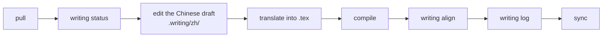

<div align="center">

# 🧰 falcary-skills

**A small, growing collection of agent skills.**<br/>
Each one is a self-contained folder you can drop into Claude Code, Codex, or any agent that reads `SKILL.md`.

[](LICENSE)


**English** · [简体中文](#简体中文)

</div>

---

## 📦 Skills

| Skill | What it does | Version |
| :-- | :-- | :-: |
| [**overleaf-ctl**](overleaf-ctl/) | Write LaTeX papers with an agent: guarded two-way sync with Overleaf, local compilation, and a Chinese-draft → English-TeX workflow with a log of every writing round. | `1.1.0` |

More are on the way. Each new skill gets its own folder and a row in this table.

## ✨ Spotlight: overleaf-ctl

Edit your Overleaf paper locally, let an agent help, and keep the two in step without leaking local notes.

- **Guarded sync.** `sync` commits, rebases onto Overleaf, and pushes. Dotfiles, build outputs, and your writing records are blocked from ever reaching Overleaf, and conflicts stop and wait for you.
- **Local compilation.** `compile` runs `latexmk` and installs missing TeX packages on demand.
- **Chinese draft first.** Every section has a Chinese draft in `.writing/zh/`. `writing status` shows which side changed since the two were last aligned, including edits made on Overleaf.
- **A log of why.** `writing log` records the intent of each round. `.writing/` is its own Git repository, so drafts have history too.



```bash
overleaf-ctl clone https://www.overleaf.com/project/<id> paper   # the page URL works as is
overleaf-ctl writing init paper
overleaf-ctl writing status paper
overleaf-ctl compile paper
overleaf-ctl sync paper --message "Rewrite the gap in the introduction"
```

Full documentation: [English](overleaf-ctl/README.md) · [简体中文](overleaf-ctl/README.zh-CN.md)

## 🚀 Quick start

Requires Python ≥ 3.10 and Git. A TeX distribution is only needed for local compilation.

```bash
git clone https://github.com/SuperFCR/falcary-skills.git
cd falcary-skills/overleaf-ctl
python3 scripts/install.py --link-skill claude --link-cli   # or --link-skill codex | agents
overleaf-ctl --version
```

## 🗂 Repository layout

```text
falcary-skills/
├── overleaf-ctl/     # one folder per skill: SKILL.md, source, docs, tests
├── LICENSE
└── README.md
```

Every skill folder stands on its own: `SKILL.md` is what the agent reads, the README is what you read, and installation steps live inside the folder.

## 📄 License

[MIT](LICENSE), for every skill in this repository unless its folder says otherwise.

---

<a id="简体中文"></a>

## 简体中文

falcary 的 agent skill 合集。每个顶层文件夹是一个独立的 skill，可以直接接入 Claude Code、Codex，或任何读取 `SKILL.md` 的 agent。

| Skill | 用途 | 版本 |
| :-- | :-- | :-: |
| [**overleaf-ctl**](overleaf-ctl/) | 和 agent 一起写 LaTeX 论文：带保护的 Overleaf 双向同步、本地编译，以及“先写中文稿、再译成英文 TeX”的写作流程，每一轮修改都有记录。 | `1.1.0` |

安装：

```bash
git clone https://github.com/SuperFCR/falcary-skills.git
cd falcary-skills/overleaf-ctl
python3 scripts/install.py --link-skill claude --link-cli
```

完整说明见 [overleaf-ctl 中文文档](overleaf-ctl/README.zh-CN.md)。许可：[MIT](LICENSE)。
