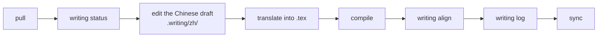
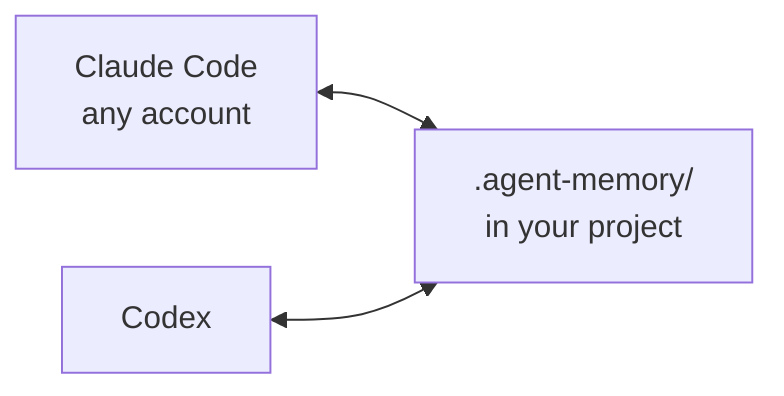

<div align="center">

# 🧰 falcary-skills

**A small, growing collection of agent skills.**<br/>
Each folder stands on its own and plugs into Claude Code, Codex, or any agent that reads `SKILL.md`.

[](LICENSE)


[](https://github.com/SuperFCR/falcary-skills/actions/workflows/pocketrig.yml)
[](https://github.com/SuperFCR/falcary-skills/actions/workflows/project-memory.yml)

**English** · [简体中文](#简体中文)

</div>

---

## 📦 What's inside

| Folder | Skills | What it does | Version |
| :-- | :-: | :-- | :-: |
| [**overleaf-ctl**](overleaf-ctl/) | 1 | Write LaTeX papers with an agent: guarded two-way sync with Overleaf, local compilation, and a Chinese-draft → English-TeX workflow with a log of every writing round. | `1.1.0` |
| [**paper-writing**](paper-writing/) | 1 | Paper figures: crop your exported PPT/Keynote PDF pages to vector figures, audit them at print width, insert/update them in your `.tex` with captions, and verify the compiled pages (`paper-drawing`). | `0.1.0` |
| [**pocketrig**](pocketrig/) | 6 | Turn an always-on computer into your AI coding workstation: reach it from your phone and Mac over Tailscale, keep it online 24/7, and run heavy jobs on GPU nodes with the results back on your phone. | `1.0.0` |
| [**project-memory**](project-memory/) | 5 | Keep what agents learn inside each project: one `.agent-memory/` shared by Claude Code, Codex and every account, plus a live handoff, so you can switch agents or resume after a usage-limit stop; preferences you state once are followed in every later session. | `1.1.0` |

More are on the way. Each new skill gets its own folder and a row in this table.

## ✨ overleaf-ctl

Edit your Overleaf paper locally, let an agent help, and keep the two in step without leaking local notes.

- **Guarded sync.** `sync` commits, rebases onto Overleaf, and pushes. Dotfiles, build outputs, and your writing records are blocked from ever reaching Overleaf, and conflicts stop and wait for you.
- **Local compilation.** `compile` runs `latexmk` and installs missing TeX packages on demand.
- **Chinese draft first.** Every section has a Chinese draft in `.writing/zh/`. `writing status` shows which side changed since the two were last aligned, including edits made on Overleaf.
- **A log of why.** `writing log` records the intent of each round. `.writing/` is its own Git repository, so drafts have history too.



**Install** (Python ≥ 3.10 and Git; a TeX distribution only for local compilation):

```bash
git clone https://github.com/SuperFCR/falcary-skills.git
cd falcary-skills/overleaf-ctl
python3 scripts/install.py --link-skill claude --link-cli   # or --link-skill codex | agents
overleaf-ctl --version
```

Documentation: [English](overleaf-ctl/README.md) · [简体中文](overleaf-ctl/README.zh-CN.md)

## ✨ pocketrig

Your workstation, in your pocket. Drive the always-on computer at home from your phone.

<div align="center">
<a href="pocketrig/README.md"></a>
</div>

- **Online 24/7.** Each instance is managed by systemd / launchd and starts at boot; on Windows, a scheduled task keeps WSL alive. Lock your phone or close your Mac, and the agent keeps running.
- **Results on your phone.** Heavy compute stays on the GPU node. Only small results such as metrics, curves, and log summaries come back to the workstation.
- **Let an agent do the setup.** Six skills cover setup, always-on, connecting devices, remote compute, diagnosis, and team use. The agent pauses for your confirmation before sudo, network changes, or reboots.
- **Yours first, then your team's.** Start with just yourself, and give family or a small team their own system users and instances later.

**Install** as a Claude Code plugin:

```text
/plugin install pocketrig --marketplace SuperFCR/falcary-skills
```

For Codex or other tools, clone this repository and run `./pocketrig/skills/install.sh --codex` (or `--target <dir>`). The skills and detailed docs are written in Chinese; agents can follow them in any language.

Documentation: [English](pocketrig/README.md) · [简体中文](pocketrig/README.zh-CN.md)

## ✨ project-memory

Memory that lives in the project, not in the agent. Switch agents or accounts mid-task, and the next session picks up where the last one stopped.

- **One memory per project.** `.agent-memory/` sits in the project and is shared by Claude Code, Codex and every account. Claude Code loads it natively through `autoMemoryDirectory`; Codex finds it through a short `AGENTS.md` block.
- **Survives a usage-limit stop.** Hooks write a checkpoint whenever a Claude session stops or fails, and a live handoff tells the next agent what is done and what comes next.
- **Learns how you work.** Say a preference once ("from now on…", "too long again") and the agent saves it to an always-loaded `## Preferences` list that every agent follows in every later session. Child projects inherit the workspace's list, a broken rule gets sharpened and moved to the top, and with your consent a rule can apply to every project.
- **Five skills.** Read at session start, learn a lesson on the spot, reflect at the end, hand off at milestones, and keep the memory healthy.
- **Private by default.** The memory stays out of the project's Git and keeps its own history, so nothing is lost; `--track` shares it with your team.



**Install** as a Claude Code plugin (Python ≥ 3.9 and Git):

```text
/plugin install project-memory --marketplace SuperFCR/falcary-skills
```

Then ask the agent to "set up project memory" in each project; it runs `pmem` from the plugin's skill folder. The plugin puts no `pmem` on your PATH; to run it yourself, link the stable copy that the agent's first `pmem init` installs: `ln -s "${XDG_DATA_HOME:-$HOME/.local/share}/project-memory/pmem.py" ~/.local/bin/pmem`. For Codex or several Claude accounts, clone this repository and run `./project-memory/install.sh --codex --wire` or `--config-dir <dir>` (repeatable); `--link-cli` adds `pmem` to your PATH.

Documentation: [English](project-memory/README.md) · [简体中文](project-memory/README.zh-CN.md)

## 🗂 Repository layout

```text
falcary-skills/
├── overleaf-ctl/        # LaTeX writing skill and its Python CLI
├── paper-writing/       # paper-production skills: paper-drawing (figures → cropped PDF → .tex)
├── pocketrig/           # six workstation skills, installers for Linux / macOS / Windows, docs
├── project-memory/      # five memory skills, the pmem CLI and its installer
├── .claude-plugin/      # marketplace manifest: installs pocketrig and project-memory as Claude Code plugins
├── .github/workflows/   # CI for pocketrig and project-memory
├── LICENSE
└── README.md
```

Inside each folder, `SKILL.md` is what the agent reads, the README is what you read, and installation steps live next to them.

## 📄 License

[MIT](LICENSE), for every skill in this repository unless its folder says otherwise.

---

<a id="简体中文"></a>

## 简体中文

falcary 的 agent skill 合集。每个顶层文件夹都能独立使用，可以接入 Claude Code、Codex，或任何读取 `SKILL.md` 的 agent。

| 文件夹 | Skill 数 | 用途 | 版本 |
| :-- | :-: | :-- | :-: |
| [**overleaf-ctl**](overleaf-ctl/) | 1 | 和 agent 一起写 LaTeX 论文：带保护的 Overleaf 双向同步、本地编译，以及“先写中文稿、再译成英文 TeX”的写作流程，每一轮修改都有记录。 | `1.1.0` |
| [**paper-writing**](paper-writing/) | 1 | 论文配图（`paper-drawing`）：把你导出的 PPT/Keynote PDF 页面裁成矢量图，按印刷宽度做质量检查，写进 `.tex` 并配 caption，编译后核对页面。 | `0.1.0` |
| [**pocketrig**](pocketrig/) | 6 | 把一台常开电脑变成 AI 编程工作站：手机和 Mac 经 Tailscale 连接，7×24 在线，重任务交给 GPU 节点，结果回到手机上看。 | `1.0.0` |
| [**project-memory**](project-memory/) | 5 | 把 agent 学到的东西放进项目本身：Claude Code、Codex 和每个账号共用一个 `.agent-memory/`，附带实时交接，换 agent 或额度用尽中断后都能接着干；说过一次的偏好之后每个会话都照做。 | `1.1.0` |

安装 overleaf-ctl：

```bash
git clone https://github.com/SuperFCR/falcary-skills.git
cd falcary-skills/overleaf-ctl
python3 scripts/install.py --link-skill claude --link-cli
```

安装 pocketrig（Claude Code 插件）：

```text
/plugin install pocketrig --marketplace SuperFCR/falcary-skills
```

安装 project-memory（Claude Code 插件，需要 Python ≥ 3.9 与 Git）：

```text
/plugin install project-memory --marketplace SuperFCR/falcary-skills
```

之后在每个项目里对 agent 说“给这个项目建记忆”，它会从插件的 skill 目录运行 `pmem`。插件不会把 `pmem` 放到 PATH 上；想自己运行，就链接 agent 第一次 `pmem init` 时装好的稳定副本：`ln -s "${XDG_DATA_HOME:-$HOME/.local/share}/project-memory/pmem.py" ~/.local/bin/pmem`。Codex 或多个 Claude 账号：克隆本仓库后运行 `./project-memory/install.sh --codex --wire`，或 `--config-dir <目录>`（可重复）；加 `--link-cli` 会把 `pmem` 放到 PATH 上。

完整说明见 [overleaf-ctl 中文文档](overleaf-ctl/README.zh-CN.md)、[pocketrig 中文文档](pocketrig/README.zh-CN.md)和 [project-memory 中文文档](project-memory/README.zh-CN.md)。许可：[MIT](LICENSE)。
