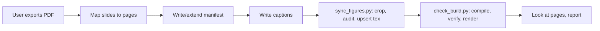

# Workflow: paper-figure-export

Turn figures that the user has finished (or edited) in PPTX/Keynote/WPS and **exported to PDF** into tightly cropped vector PDFs, integrate them into a target `.tex`, and verify the final paper pages. The workflow is built to be re-run: when the deck changes, the user re-exports, the agent re-syncs, and the existing LaTeX blocks are updated in place.

`SK=<skill dir>/scripts`, `PAPER=<paper root>`. Do scratch work in the conversation's scratch dir, never in the paper repo.



## Inputs to collect

| Input | Example | If missing |
| :-- | :-- | :-- |
| Exported PDF | `~/…/202611_cvpr_定性.pdf` | Ask the user to export it (step 0). |
| Slides/pages wanted | slides 3, 4, 5 | Ask. Show thumbnails if it's ambiguous. |
| Paper root + target `.tex` | `PAPER`, `sections/X_appendix.tex` | Ask. |
| Deck path (optional) | `…/202611_cvpr_定性.pptx` | Without it there is no staleness check. |

## 0. The user exports the PDF

Tell the user:
- **PowerPoint (Mac)**: File → Export… → PDF. If options appear, choose "Best for printing", and uncheck "Bitmap text when fonts are not embedded".
- **Keynote**: File → Export To → PDF… → Image Quality **Best**.
- **WPS**: Export to PDF with picture quality **highest**.
- Use **Export**, not Print → Save as PDF. Exporting the whole deck is fine. Save the deck (⌘S) before exporting.

## 1. Map slides → PDF pages

```bash
pdfinfo deck.pdf | grep -E "Pages|Page size"
for p in 3 4 5; do echo "== $p"; pdftotext -layout -f $p -l $p deck.pdf - | grep -v '^\s*$' | head -8; done
pdftoppm -r 30 -png deck.pdf scratch/thumb    # thumbnails if unsure
```
Hidden slides are skipped on export, which shifts page numbers. If the `.pptx` is available, `show="0"` in `ppt/slides/slideN.xml` marks hidden slides, and the real order is the `sldIdLst` in `ppt/presentation.xml` (the file numbering is not the order). Confirm with the user if there's any doubt.

## 2. Write or extend the manifest

`PAPER/.paper-drawing/figures.json` is a local-only dot-dir (overleaf-ctl never pushes it). Full schema: [../references/manifest.md](../references/manifest.md). One entry per figure:
```json
{"id": "appx_qual_comparison_1", "source_pdf": "/abs/deck.pdf", "source_deck": "/abs/deck.pptx",
 "page": 4, "out": "figures/fig_appx_qual_comparison_1.pdf", "tex": "sections/X_appendix.tex",
 "label": "fig:appx_qual_comparison_1", "env": "figure*", "placement": "p",
 "graphics": "width=\\textwidth,height=.88\\textheight,keepaspectratio",
 "crop": {"margin_pt": 1, "drop_edge_rules": true},
 "caption": "\\textbf{...} ...", "anchor": "end"}
```
Sizing rules (CVPR: `\textwidth` 496.8 pt, column 237.1 pt, `\textheight` ≈ 639 pt). Get the aspect ratio from a dry run (`crop_pdf.py … -o /tmp/x.pdf`):

| Cropped aspect w/h | env / placement | graphics |
| :-- | :-- | :-- |
| ≥ ~1.3, or a dense grid | `figure*` `[t]` | `width=\textwidth` |
| < ~1 (full-page grid) | `figure*` `[p]`/`[t]` | `width=\textwidth,height=.88\textheight,keepaspectratio` |
| Small/simple, readable at ~237 pt | `figure` `[t]` | `width=\linewidth` |
| > ~4 (thin strip) | Merge with a neighbouring figure, or place `[t]` next to related text; a strip alone gets an empty-looking float page | – |

Crop options: the default is outer whitespace only. Turn on `drop_edge_rules` for comparison-grid slides that end in a thin divider (it never touches labels). Use `strip_bands` **only** if the user wants a slide title or caption removed. On qualitative grids it removes the column labels (verified: it strips "Ours / Minimax-H3" at the top).

## 3. Write captions

Follow [../references/caption-guide.md](../references/caption-guide.md). Put the caption in the manifest; it is used only when the block is first inserted. After that the `.tex` is canonical: re-syncs never overwrite a caption, so later caption edits are made directly in the `.tex`.

## 4. Sync

```bash
python3 $SK/sync_figures.py $PAPER --dry-run   # preview actions
python3 $SK/sync_figures.py $PAPER             # or --only id1,id2
```
For each entry this:
1. checks staleness (warns if the deck is newer than the PDF);
2. resolves the page via `match_text`, so a slide inserted earlier in the deck is followed automatically;
3. crops and audits at the printed size;
4. copies the file only if its bytes changed;
5. upserts the `\includegraphics` line in the block with the same `\label`, or inserts a new block at `anchor` (`end` or `after:<label>`).

Finally it checks that every label and file is referenced exactly once. The preview is written to `PAPER/.paper-drawing/previews/<id>.png`; **open it.**

Re-export loop (the acceptance case): the user edits the deck → re-exports the PDF (same path, or pass `--source-pdf NEW.pdf`) → `sync_figures.py` → `check_build.py`. Expected result: the files are updated, the `.tex` blocks are updated in place with no duplicates, and captions are untouched.

Audit findings (details: [../references/quality-checklist.md](../references/quality-checklist.md)): an `ERROR` must be fixed (non-embedded font, < 200 ppi). For a `WARN`, judge it and mention it. `NOTE image-jpeg` is normal for photo panels exported from PPT.

## 5. Build check

```bash
# target compiled by default:
python3 $SK/check_build.py $PAPER --manifest
# target commented out in main.tex (e.g. appendix): compile a scratch copy only
python3 $SK/check_build.py $PAPER --manifest --scratch <scratch>/build --enable-input X_appendix
```
This verifies that LaTeX used **these** files (path tracing), that each label is defined once, that there are no undefined/multiply-defined refs or `Float too large`, and it finds each figure's physical page and renders `contact_sheet.png`. **Look at the contact sheet.** Check placement, empty float pages, whether the caption is adjacent, and readability at print size. `--enable-input` uncomments only the `\input` line plus the contiguous commented *commands* above it (e.g. `\clearpage`, `\appendix`, `\maketitlesupplementary`), and only in the copy.

## 6. Report

Report: the files created or updated; the `.tex` changes (inserted vs updated blocks); for each figure, the printed size, min ppi and min text pt; audit warnings; the build `RESULT` with the contact sheet path; and judgement calls (crop options, float placement, caption claims, name normalisation). Point out anything that is still a TODO (e.g. `\TODO{caption}`).

## Troubleshooting

| Symptom | Fix |
| :-- | :-- |
| `match_text not found uniquely` | Slides were edited or duplicated. Set `page` (and clear `match_text`) after checking the thumbnails. |
| `source PDF is OLDER than the deck` | Ask the user to save and re-export. Use `--strict` to make it fatal. |
| `file … NOT USED by this build` | Wrong `out` path, a stale `\includegraphics` path elsewhere, or the target `.tex` isn't compiled (use `--scratch --enable-input`). |
| bbox too large (faint background) | `"thresh": 240` in `crop`. |
| Light element clipped | `"thresh": 254`, or a bigger `margin_pt`. |
| PDF too large for the venue | `"jpeg_quality": 85` in `crop` (lossy). Re-audit the ppi afterwards. |
| `Ignoring wrong pointing object` | A harmless pypdf message about PowerPoint PDFs. |
