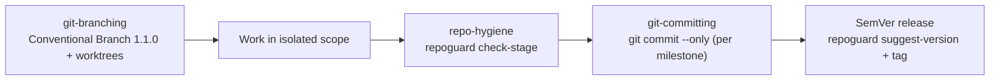

# proj-standards

**English** | [简体中文](README.zh-CN.md)

**Git & repository governance built for human + multi-agent workflows.** Enforce [Conventional Branch 1.1.0](https://conventionalbranch.org), Conventional Commits 1.0.0, per-milestone atomic commits, shared-workspace commit isolation, secret/size stage audits, and SemVer releases with a zero-dependency Python CLI (`repoguard`).

## Why this package

Teams using Claude Code, Codex, and linked git worktrees hit the same failure modes repeatedly: inconsistent branch casing across macOS/Windows/Linux, huge dirty working trees spanning multiple packages instead of committing each completed milestone, `git add -A` sweeping in another agent's staged work, and leaked `.env` files, local notes (`CLAUDE.local.md`), or multi-megabyte model weights. `proj-standards` pairs three actionable skills with a deterministic stdlib validator.

## How it works



- **[git-branching](skills/git-branching/SKILL.md)** covers [Conventional Branch 1.1.0](https://conventionalbranch.org) (`feature`/`feat`, `bugfix`/`fix`, `hotfix`, `release`, `chore`, plus AI agent prefixes `ai`, `claude`, `codex`, `copilot`, `cursor`), clear purpose-vs-AI prefix policy, legacy-branch exemption, and safe git worktree creation/cleanup.
- **[git-committing](skills/git-committing/SKILL.md)** enforces atomic commits per completed package/milestone, Conventional Commits 1.0.0, pre-commit `git status` + `git diff --cached` checks, `--only` isolated commits in shared worktrees, and strict approval gates before destructive commands or `git push`.
- **[repo-hygiene](skills/repo-hygiene/SKILL.md)** keeps machine-local files in `.git/info/exclude`, audits staged blobs/secrets/sizes, computes SemVer bumps from commit history, and ships optional zero-dependency Git hooks plus `commit-check` / GitHub Rulesets templates.

## Install

Requires Python 3.9 or newer and Git. Pick the target for each agent:

**Claude Code plugin**, inside Claude Code:

```text
/plugin install proj-standards --marketplace SuperFCR/falcary-skills
```

**Copy install**, for Claude Code, Codex, Antigravity or any agent reading `SKILL.md`:

```bash
git clone https://github.com/SuperFCR/falcary-skills.git && cd falcary-skills/proj-standards
./install.sh --link-cli              # -> ${CLAUDE_CONFIG_DIR:-~/.claude}/skills, links ~/.local/bin/repoguard
./install.sh --codex                 # -> ${CODEX_HOME:-~/.codex}/skills
./install.sh --antigravity           # -> ${ANTIGRAVITY_HOME:-~/.gemini/config}/skills
./install.sh --target DIR            # any other skills folder
```

Existing skills with the same name are backed up safely to `<target>.bak/<name>-<timestamp>`. Without `--link-cli`, invoke the CLI via `python3 <skills dir>/repo-hygiene/scripts/repoguard.py`.

## Quick start

```bash
repoguard check-branch feat/add-auth          # validate branch name (prints suggestion if invalid)
repoguard check-commit "feat(cli): add flag"  # validate Conventional Commit header
repoguard check-stage                         # audit staged files for secrets, private files and size
repoguard suggest-version                     # compute next SemVer tag & changelog draft
repoguard install-hooks                       # optionally wire pre-commit / commit-msg / pre-push hooks
repoguard print-config commit-check           # output CI / GitHub Ruleset / .proj-standards.json templates
```

## Policy highlights

| Rule | Default policy | Customization |
|---|---|---|
| Branch naming | Strict Conventional Branch 1.1.0 on new branches; legacy branches exempt | `allow_branch_types` in `.proj-standards.json` |
| Purpose vs AI prefix | Prefer purpose prefix (`feat/`, `fix/`, `chore/`) when agents hand off; use `claude/` / `codex/` / `ai/` for autonomous single-agent branches | Never stack two `/` prefixes (`claude/feat/...` is invalid) |
| Shared worktrees | Never blind `git add -A`; audit index first and commit via `git commit --only -- <paths>` | Same rule in every repo |
| Milestone cadence | Commit cleanly once each major part / package milestone is verified | — |
| Push & destructive ops | Always ask before `git push`, `--force`, `reset --hard`, `branch -D`, `clean -fdx`, `worktree remove` | — |

## repoguard at a glance

| Subcommand | Purpose |
|---|---|
| `repoguard check-branch [name]` | Validate current HEAD or given name against Conventional Branch 1.1.0; suggest valid slug on failure |
| `repoguard check-commit [msg\|--file]` | Validate Conventional Commits 1.0.0 header, ignoring `#` git comments and auto headers unless `--strict` / `--no-git-auto` |
| `repoguard check-stage` | Catch staged private files (`CLAUDE.local.md`, `.env`, keys), oversized blobs/weights, and added secret tokens |
| `repoguard suggest-version` | Read commits since latest `vX.Y.Z` tag and output next SemVer (`vMAJOR.MINOR.PATCH`) + changelog bullets |
| `repoguard install-hooks` | Install worktree-safe POSIX hooks without overwriting non-repoguard hooks unless `--force` |
| `repoguard print-config <kind>` | Emit `commit-check` TOML, `github-ruleset` JSON, or starter `.proj-standards` JSON |

## Development

```bash
cd proj-standards
python3 -m unittest discover -s tests -t . -v
```

The test suite requires Git and runs inside isolated temporary directories without touching user configs. CI validates `install.sh` with `shellcheck` and runs tests on Ubuntu, macOS, and Python 3.9.

## License & Notices

Code and skill prose are licensed under [MIT](../LICENSE). Specifications incorporated from Conventional Branch 1.1.0 (CC BY 4.0), Conventional Commits 1.0.0 (CC BY 3.0), and SemVer 2.0.0 (CC BY 3.0) are attributed in [THIRD_PARTY.md](THIRD_PARTY.md).
