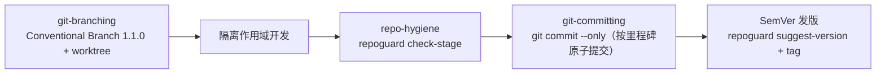

# proj-standards

[English](README.md) | **简体中文**

**面向人类与多 Agent 协作的 Git 仓库工程规范包。** 将 [Conventional Branch 1.1.0](https://conventionalbranch.org/zh/) 分支规范、Conventional Commits 1.0.0 提交规范、大 Part 里程碑原子提交纪律、共享工作区防误提护栏、提交前隐私/大文件扫描与 SemVer 发版打包为可执行的 skill 与零依赖命令行工具（`repoguard`）。

## 为什么做这个包

当 Claude Code、Codex 与多个 git worktree 同时在一个团队或个人多仓库体系中工作时，最常反复踩的坑只有几类：分支命名随手写导致跨系统（macOS/Windows 不区分大小写）冲突或 CI 难解析；几个大模块长期堆在工作区一起提交，拆不动也没法按包回退；多会话共享工作区用 `git add -A` 误把别人的改动或已有暂存区吃进本次提交；或者不慎把 `.env`、`CLAUDE.local.md`、模型权重或令牌提交进 Git 历史。`proj-standards` 用 3 个职责正交的 skill 加一个零依赖 Python CLI 把这些护栏固化下来。

## 工作方式



- **[git-branching](skills/git-branching/SKILL.md)**：完整落地 [Conventional Branch 1.1.0](https://conventionalbranch.org/zh/)（`feature`/`feat`、`bugfix`/`fix`、`hotfix`、`release`、`chore`，以及 1.1.0 新增的 AI 来源前缀 `ai`、`claude`、`codex`、`copilot`、`cursor`），明确「多 Agent 接力优先用用途前缀、单 Agent 自主分支用来源前缀、禁止双斜杠叠前缀、仅约束新建分支、历史分支豁免」策略，以及 `git worktree` 安全隔离与清理红线。
- **[git-committing](skills/git-committing/SKILL.md)**：沉淀「每个大 Part / 独立包完成后立即单独 commit」纪律、Conventional Commits 1.0.0 规范、`git status` + `git diff --cached` 前置审计、共享工作区 `git commit --only -- <paths>` 防误提交协议，以及 `git push` / 历史改写先征求确认的红线。
- **[repo-hygiene](skills/repo-hygiene/SKILL.md)**：区分 `.gitignore` 与 `.git/info/exclude`，拦截私密文件、疑似密钥与大体积权重/文件，按提交历史计算 SemVer 升级与 CHANGELOG 草稿，并支持安装零依赖 Git Hooks 及导出 `commit-check` / GitHub Rulesets 配置。

## 安装

需要 Python 3.9 及以上和 Git。按使用的 Agent 选择安装方式：

**Claude Code 插件**，在 Claude Code 中执行：

```text
/plugin install proj-standards --marketplace SuperFCR/falcary-skills
```

**复制安装**，适用于 Claude Code、Codex、Antigravity 或任意读取 `SKILL.md` 的工具：

```bash
git clone https://github.com/SuperFCR/falcary-skills.git && cd falcary-skills/proj-standards
./install.sh --link-cli              # → ${CLAUDE_CONFIG_DIR:-~/.claude}/skills，并链接 ~/.local/bin/repoguard
./install.sh --codex                 # → ${CODEX_HOME:-~/.codex}/skills
./install.sh --antigravity           # → ${ANTIGRAVITY_HOME:-~/.gemini/config}/skills
./install.sh --target DIR            # 其他 skills 目录
```

已存在的同名 skill 会先移动到 `<目标目录>.bak/<name>-<时间>`。未传 `--link-cli` 时，直接用 `python3 <skills目录>/repo-hygiene/scripts/repoguard.py` 运行 CLI。

## 快速开始

```bash
repoguard check-branch feat/add-auth          # 校验分支名（不合格时自动给出合法建议）
repoguard check-commit "feat(cli): add flag"  # 校验 Conventional Commit 标题
repoguard check-stage                         # 扫描暂存区：私钥/秘钥/私密文件/超大体积
repoguard suggest-version                     # 根据提交历史推导下一 SemVer tag 与变更摘要
repoguard install-hooks                       # 可选在当前仓库安装 pre-commit / commit-msg / pre-push hooks
repoguard print-config commit-check           # 输出 commit-check / GitHub Ruleset / .proj-standards.json 配置
```

## 核心规则要点

| 维度 | 默认约定 | 可扩展方式 |
|---|---|---|
| 分支命名 | 仅对新建分支严格校验 Conventional Branch 1.1.0；既有历史分支豁免 | 在项目根 `.proj-standards.json` 中配置 `allow_branch_types` |
| 用途 vs AI 前缀 | 多 Agent/人工接力默认优先用途前缀（`feat/`、`fix/`、`chore/`）；单 Agent 独立 PR/实验用 `claude/`、`codex/`、`ai/` | 严格单 `/`，禁止 `claude/feat/...` 叠加 |
| 共享工作区 | 严禁盲目 `git add -A`；先查暂存区，若已有他人暂存则只用 `git commit --only -- <paths>` | 全部仓库通用 |
| 里程碑提交 | 每完成一个大 Part 或独立模块并验证通过，立即单独 commit 以保证包边界清晰 | — |
| 推送与破坏性操作 | `git push`、强推、`reset --hard`、`branch -D`、`clean -fdx`、删 worktree 一律先问用户 | — |

## repoguard 速览

| 子命令 | 作用 |
|---|---|
| `repoguard check-branch [name]` | 按 Conventional Branch 1.1.0 校验当前 HEAD 或指定分支名，不合格时输出建议名 |
| `repoguard check-commit [msg\|--file]` | 校验 Conventional Commits 1.0.0 标题，自动跳过 `#` 注释与 git 自动提交（可加 `--strict` / `--no-git-auto`） |
| `repoguard check-stage` | 拦截被误加暂存区的本地私密文件（`CLAUDE.local.md`、`.env`、密钥）、超大文件/权重与新增行密钥字面量 |
| `repoguard suggest-version` | 读取最近一个 `vX.Y.Z` tag 之后的提交历史，推导下一 SemVer（`vMAJOR.MINOR.PATCH`）并生成发布摘要 |
| `repoguard install-hooks` | 安装兼容 worktree 的零依赖 POSIX hooks，默认不覆盖用户既有自定义 hook（`--force` 才替换） |
| `repoguard print-config <kind>` | 打印 `commit-check`、`github-ruleset` 或 `.proj-standards` 起步配置 |

## 开发与测试

```bash
cd proj-standards
python3 -m unittest discover -s tests -t . -v
```

测试依赖 Git，全程在隔离临时目录运行，不改动本机任何配置。CI 在 Ubuntu、macOS 与 Python 3.9 上运行全部测试，并对 `install.sh` 跑 `shellcheck`。

## 许可证与第三方署名

代码与 skill 文档采用 [MIT](../LICENSE) 许可；所引用的 Conventional Branch 1.1.0（CC BY 4.0）、Conventional Commits 1.0.0（CC BY 3.0）与 SemVer 2.0.0（CC BY 3.0）署名见 [THIRD_PARTY.md](THIRD_PARTY.md)。
