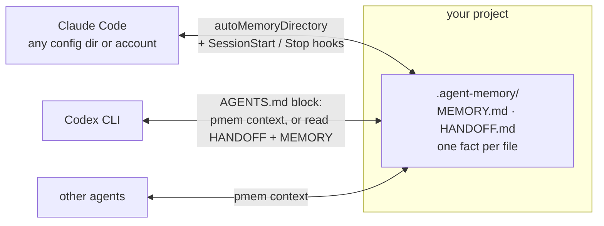

# project-memory

**English** | [简体中文](README.zh-CN.md)

**Memory that lives in the project, not in the agent.** Claude Code, Codex and every account you use read and write one `.agent-memory/` folder, so you can resume a project or switch agents at any moment, even when a session dies on a usage limit.

## The problem

Claude Code keeps its auto-memory under `<config-dir>/projects/<slug of the launch path>/memory/`. That location is tied to one agent, one config dir or account, one machine path and one launch path: Codex never sees it, a second account starts empty, and every worktree or sub-directory grows its own separate memory. When a session stops on a usage limit and you switch to Codex or another account, the new session starts blind. project-memory moves the memory into the project itself and teaches every agent to read it first.

## How it works



- **Claude Code.** `pmem init` writes `autoMemoryDirectory` into the project's `.claude/settings.local.json`, so Claude's native memory loads `MEMORY.md` from `.agent-memory/` and saves new memories there. The same file adds hooks: `SessionStart` injects the current handoff and any checkpoint that needs attention, while `Stop`, `StopFailure` and `PreCompact` write a mechanical checkpoint. The settings file lives in the project, so every config dir and account picks it up.
- **Codex.** `pmem wire codex` adds a short block to `${CODEX_HOME:-~/.codex}/AGENTS.md`: find the nearest `.agent-memory/`, run `pmem context` (or read `HANDOFF.md`, a newer checkpoint and `MEMORY.md`), and stamp `metadata.modified` on every edit.
- **Anything else.** `pmem context` prints the handoff, the checkpoint and the index in one go.
- **Five skills** tell the agent when to read, save, hand off and clean up. `pmem`, a single-file Python CLI for Python 3.9 and newer with only the standard library, does the bookkeeping.

## Install

You need Python 3.9 or newer and Git. Pick one way per agent.

**Claude Code plugin**, inside Claude Code:

```text
/plugin install project-memory --marketplace SuperFCR/falcary-skills
```

On older Claude Code versions use two steps: `/plugin marketplace add SuperFCR/falcary-skills`, then `/plugin install project-memory@falcary-skills`.

**Copy install**, for Claude Code, Codex or any agent that reads `SKILL.md` folders:

```bash
git clone https://github.com/SuperFCR/falcary-skills.git && cd falcary-skills/project-memory
./install.sh --link-cli              # → ${CLAUDE_CONFIG_DIR:-~/.claude}/skills, plus ~/.local/bin/pmem
./install.sh --codex --wire          # → ${CODEX_HOME:-~/.codex}/skills, plus the AGENTS.md block
./install.sh --config-dir ~/.claude-work --config-dir ~/.claude-personal   # several accounts
./install.sh --target DIR            # any other skills directory
```

An existing skill with the same name is moved to `<target>.bak/<name>-<time>`, outside the directory agents scan. `--wire` runs `pmem wire codex` for `--codex` and `pmem wire claude` for each Claude config dir.

**Once per Claude config dir.** Claude Code keeps plugins, skills and the global `CLAUDE.md` per config dir (`~/.claude` or `$CLAUDE_CONFIG_DIR`). If you switch accounts by switching config dirs, install the plugin in each one, or pass every dir to `install.sh --config-dir`. The project wiring is shared: it lives in the project, and the hook script is a stable copy at `${XDG_DATA_HOME:-~/.local/share}/project-memory/pmem.py`, outside any config dir. After updating the plugin or skills, run `pmem init` once in any project with the updated `pmem.py` from the skill folder to refresh that copy.

**The `pmem` command.** `--link-cli` puts it on your PATH; the plugin does not. Plugin users can ask the agent to "set up project memory"; it runs `pmem.py` from the skill folder. After the first `pmem init`, link the stable copy with `ln -s "${XDG_DATA_HOME:-$HOME/.local/share}/project-memory/pmem.py" ~/.local/bin/pmem`; Claude sessions also name that copy in their injected context (`CLI: python3 '…'`). Without a link, `pmem` below means `python3 <skills dir>/project-memory/scripts/pmem.py`.

## Quick start

Once per project. In a Git repository run it anywhere: it lands in the main checkout root. Elsewhere, run it in the project's top folder or pass `-C <root>`:

```bash
pmem init              # create .agent-memory/, private history, Claude wiring
pmem import --claude   # bring over Claude's old per-path memories; try --dry-run first
pmem wire codex        # once per machine: tell Codex where to look
pmem status            # check the wiring
```

Start a new Claude Code session afterwards; settings are read at startup. Notes kept in `CLAUDE.local.md` can come along with `pmem import --file CLAUDE.local.md`. Memories Claude kept for parent dirs, a user-level `autoMemoryDirectory` or sessions launched in sub-directories are listed as candidates, not imported; sub-directory ones are confirmed by the `cwd` in their transcripts. Bring each in with `pmem import <dir>` after a look. `init` is idempotent, so running it again only repairs what is missing.

## Daily use

You rarely call the skills by name. They fire on what happens in the conversation:

| Skill | Fires when | You might say |
| --- | --- | --- |
| [project-memory](skills/project-memory/SKILL.md) | Session start or resume, before debugging an error, any memory question; also setup and migration | "set up project memory", "where is the memory" |
| [memory-learn](skills/memory-learn/SKILL.md) | Right after a correction, a confirmed unusual approach, a fix that took 3+ attempts, a new constraint | "remember this", "learn this", "don't do that again" |
| [memory-reflect](skills/memory-reflect/SKILL.md) | End of session or before a commit: sweeps the whole conversation | "done for today", "wrap up" |
| [memory-handoff](skills/memory-handoff/SKILL.md) | Milestones, before long or remote jobs, before stopping, when switching agents | "hand off", "continue the last task", "switch to Codex" |
| [memory-health](skills/memory-health/SKILL.md) | Weekly, or when `pmem lint` warns: verify, merge, split, archive, shrink the index | "memory health", "clean up the memory" |

A typical day: the agent reads the handoff at session start, saves lessons as they happen, updates the handoff at each milestone, and runs a reflect sweep at the end. Agents act on their own for low-risk changes such as a new memory or their own handoff, report rewrites of existing memories, and ask before archiving a memory that still holds unique content, weakening an existing rule, or touching `CLAUDE.md` / `AGENTS.md`, `pmem wire` included. Nothing is ever deleted: `pmem archive` moves files to `.archive/`, and that is also what "forget this" does. Dropping only the index line is not enough, because `pmem index --fix` would add it back.

## Switching agents and accounts

The handoff is the contract between sessions: goal, what is done, the next step, live state with a command to check each item, decisions in force and open questions. Agents keep it current at milestones, so an abrupt stop loses little.

When a Claude Code session dies on a usage limit:

| Step | What happens |
| --- | --- |
| 1. Session stops | The `StopFailure` (or `Stop`) hook writes `.checkpoints/<key>.md`: time, error, session id, transcript path, branch, HEAD, dirty file count, the tail of the last assistant message. A checkpoint left by an earlier session moves to `<key>.prev.md` first. The hook never edits the handoff. |
| 2. You switch | Open Codex in the same project, or Claude Code with another account. |
| 3. Next session starts | Claude gets the handoff injected together with the full checkpoint, headed by the error type, e.g. `rate_limit`. Codex's AGENTS.md block has it run `pmem context`, which shows the same; without `pmem` it reads the handoff and the checkpoint file. |
| 4. Catch up, in the first reply | `pmem sessions --since-handoff --tail 20` lists this workstream's sessions since the handoff, including the dead one in another config dir named by the checkpoints and sessions launched in sub-directories, and prints their last messages. |
| 5. Continue | The agent verifies the live state (branch, HEAD, jobs, remote dirs), records the old transcript path, updates the handoff and carries on. |

Why the first reply: the new session's own checkpoints push the failure out. It survives as `<key>.prev.md` for the rest of that session and is gone after the next one; from then on only `pmem sessions --config-dir <old account dir>` finds the old transcript. Read the sessions before editing the handoff, because the edit moves the `--since-handoff` cutoff to now.

pmem weighs the current checkpoint and the previous session's. Either one is shown in full if it is a `StopFailure` newer than the handoff, or more than 10 minutes newer than the handoff, meaning the handoff fell behind; the `Stop` hook fires after every turn, so a slightly newer checkpoint is normal. Otherwise the session start shows one line: "Last session ended normally at … (session …, transcript …); handoff is current." after a stop, or "Last checkpoint: PreCompact at … (session …)" after a compaction. The handoff's time is the later of its `metadata.modified` and the file's modification time, so an agent that forgets the timestamp raises no false alarm. Once the handoff is newer than the failure, the full section goes away.

Codex sessions get no automatic checkpoint, so the handoff is what carries the state; `pmem sessions` still finds Codex transcripts.

## What's on disk

```text
<project>/.agent-memory/
  MEMORY.md              index, loaded natively by Claude Code
  HANDOFF.md             live state of the main checkout (not a memory)
  handoffs/<key>.md      live state of parallel workstreams (linked worktrees or --key)
  <name>.md              one fact per file
  .archive/              retired memories (handoffs under .archive/handoffs/), hidden from native scans
  .checkpoints/<key>.md  written by hooks only; <key>.prev.md keeps the previous session's
  .git/                  private history (default)
  .gitignore, .imported.json, .pmem.lock
```

A memory file uses the same frontmatter Claude Code writes natively:

```markdown
---
name: tests-need-redis
description: Integration tests need Redis on port 6379; without it they fail with connection refused instead of skipping
metadata:
  type: project
  modified: 2026-11-23T02:31:00Z
---

Start Redis before the integration tests.
**Why:** the fixtures never check for Redis, so the failure looks like a code bug.
**How to apply:** run `redis-cli ping` before `pytest tests/integration`.
```

- **Types:** `user`, `feedback`, `project`, `reference`. A fix that took several attempts becomes `fix-<topic>`, its description starting with the verbatim error, its body holding `**Symptom:**`, `**Root cause:**` and `**Fix:**`.
- **Index:** one line per memory in `MEMORY.md`, `- [Title](name.md) — hook`, with the HANDOFF line first. pmem only edits such link lines and leaves headings and prose alone; links inside code spans, HTML comments and fenced blocks do not count.
- **Links:** `[[name]]` between memories; absolute dates only.

Claude Code loads at most 200 lines or 25,000 characters of the index and shows the first 4096 bytes of a memory file when recalling it, so `pmem lint` sets tighter limits:

| Check | Warn | Error |
| --- | --- | --- |
| Index lines | 150 | 200 |
| Index characters | 20,000 | 25,000 |
| Memory or handoff file | 4 KB | |
| Index line length | 150 chars | |
| Handoff age | 14 days | |

## Git, privacy and private history

- **Private by default.** `pmem init` adds `.agent-memory` and `.claude/settings.local.json` to the project's `.git/info/exclude`, so nothing shows up in `git status` and nothing is committed or pushed.
- **Private history.** The memory folder is its own small Git repository. pmem snapshots after every change it makes and, in the background, at each Claude session start. Those snapshots fold in everyone's edits, so review with `pmem diff --since-health`: everything native memory or other agents changed since the last memory-health run. `pmem history` shows the log and `pmem restore` brings back a file. History commands only ever touch `.agent-memory/.git`; if it is broken, pmem reports "private history broken" and never falls back to the project's repository. As a nested repository the folder is skipped by the project's `git clean -fdx`; only `git clean -ffdx` removes it. Opt out with `--no-history`; the memory is then just an ignored folder, and `git clean -fdx` deletes it.
- **Shared with the team.** `pmem init --track` stops excluding the memory, so you commit it with the project; handoffs and checkpoints stay ignored. In that mode, keep personal `user` facts out and run `pmem lint --strict` before committing.
- **One mode per repository.** Git treats ignored files as disposable. Once anyone commits `.agent-memory/`, with `--track` or by accident, a `git pull` or checkout of that commit silently overwrites a private memory, and switching back can delete it. pmem warns at init, in `status` and `lint`, and at session start whenever any ref tracks `.agent-memory`. Snapshot before such a pull: `pmem restore` only recovers up to the last snapshot.
- **No secrets.** Memories record where a credential lives, never its value. `pmem lint` flags private keys, cloud and GitHub tokens, passwords in URLs and `password=`-style assignments; mark a deliberate line with `pmem:allow-secret`. A value that slipped in stays in the private history after you delete it, and in project commits with `--track`: treat it as leaked and rotate it.
- **Background consolidation off.** Claude's auto-dream may rewrite or delete memory files, so init sets `autoDreamEnabled: false` for the project. `--allow-dream` leaves it alone; the private history makes its edits reviewable.
- **Refusals.** pmem refuses a `.agent-memory` that resolves to `$HOME`, one of its parents, `/`, or the project root or one of its parents, such as a symlink shipped in a repository, and it never follows symlinks inside the folder; `pmem lint` reports them as errors. `pmem init` also refuses, unless you pass `--force`, to reuse a memory folder the project's Git tracks without `--track`, and to write Claude settings when the Claude root would be `$HOME`, one of its parents or `/`, as when `$HOME` is a dotfiles repository.

## Worktrees, parallel agents and non-git workspaces

- **Linked worktrees share the main checkout's memory.** pmem and Claude Code both resolve `.agent-memory/` from the main checkout, so all worktrees see the same facts; `pmem status` inside a worktree confirms it. Each linked worktree gets its own handoff, `handoffs/<worktree-name>.md`, while the main checkout uses `HANDOFF.md`. A worktree named `main`, common in bare-repository layouts, gets `handoffs/worktree-main.md`. Once a worktree is removed, memory-health retires its handoff with `pmem archive handoffs/<name>`; `HANDOFF.md` itself is never archived.
- **Parallel agents.** Prefer one worktree per agent. Two agents in one checkout each need a key: start one as `PMEM_KEY=agent-b claude` or `PMEM_KEY=agent-b codex`, and its hooks and every pmem command use `handoffs/agent-b.md` and a separate checkpoint. `--key NAME` on a single command works too, but hooks only see the environment variable. Codex passes `PMEM_KEY` on to the commands it runs unless its `shell_environment_policy` drops names containing `KEY` (`ignore_default_excludes = false`). Index edits run under a file lock, and one fact per file keeps write conflicts rare.
- **Never inside a linked worktree.** `git worktree remove` deletes ignored files, so `pmem init` refuses to create memory there and `pmem status` reports it as an error.
- **Non-git workspaces.** Run `pmem init` in the top folder of a workspace that holds several repositories, such as a paper with its code and tools: it creates one memory there and wires every child repository within two levels to it. Outside Git, Claude Code reads `.claude/settings.local.json` only from the folder it starts in, so start Claude in the top folder or inside a child repository. A session started in a plain sub-folder gets neither the memory nor the hooks, and `pmem status` there reports the wiring as not effective. A repository with its own `.agent-memory/` keeps it: the nearest memory wins and nested memories are never merged.
- **New clone or machine.** `.claude/settings.local.json` is machine-local, so run `pmem init` again there. In private mode the memory does not travel with the project; sync `.agent-memory/` yourself, it is a Git repository.

## Codex notes

- Codex reads `${CODEX_HOME:-~/.codex}/AGENTS.md` and the `AGENTS.md` files from the repository root down to the working directory, not `CLAUDE.md`. `pmem wire codex` adds the project-memory block to the global file; run it once per `CODEX_HOME`. `pmem wire <root>/AGENTS.md` puts it in a project file instead, and `pmem status` recognises either. Verified: Codex launched in a sub-directory found and read `<root>/.agent-memory/MEMORY.md`.
- If your project keeps its instructions only in `CLAUDE.md`, set `project_doc_fallback_filenames = ["CLAUDE.md"]` in Codex's `config.toml` so Codex reads them too.
- **Checkpoints from Claude.** The block asks Codex to run `pmem context` at session start, which shows the handoff together with any checkpoint a stopped Claude session left. That needs `pmem` on Codex's PATH, e.g. via `install.sh --link-cli`; otherwise Codex reads `HANDOFF.md` and `.checkpoints/<key>.md` directly.
- **Sandbox.** With `workspace-write`, Codex may write only below its working directory, plus `/tmp` and `$TMPDIR` unless those are excluded, so a project under `/tmp` never shows the problem. Launched from a sub-directory, a child repository or a linked worktree, it cannot save to the memory above it: launch it from the project root, or add `--add-dir <project root>`. Not the memory folder itself: Codex keeps `.git` read-only inside every writable root, so `--add-dir <memdir>` would block the private history. `pmem status` prints the root to launch from and the `--add-dir` path.
- Codex has its own global `[memories]` feature. It is separate and can stay on; the block tells Codex that project knowledge belongs in `.agent-memory/`.
- Codex hooks are not wired in this version, so a Codex session that stops abruptly leaves no checkpoint.

## Coming from /learn, /reflect and /evolve

An older harness wrote lessons into Claude's per-path memory and routed signals through an `evolve-queue.jsonl` processed by background agents. This package replaces it:

| Old | New | What changed |
| --- | --- | --- |
| `/learn` | [memory-learn](skills/memory-learn/SKILL.md) | Same 30-second single lesson, written to the shared `.agent-memory/` and deduplicated with `pmem find` |
| `/reflect` | [memory-reflect](skills/memory-reflect/SKILL.md) | Sweeps the conversation and writes directly under the change-risk table; still reminds you of unfinished entries in an experiment log |
| `/evolve` report and context slimming | [memory-health](skills/memory-health/SKILL.md) + `pmem lint` | Stale, oversized and duplicate memories, broken links and missing paths are lint findings; `pmem diff --since-health` replaces the change log |
| `/evolve sweep`, evolve-trigger rule, queue | Save triggers in [project-memory](skills/project-memory/SKILL.md) | The agent that saw the event saves it at once |
| harness-evolution rule | Failure-mode convention + change-risk table | `fix-<topic>` memories with Symptom / Root cause / Fix; "search memory before debugging" |
| harness-health | Not ported | Auditing a project's own rules and agent files against its code is project-specific; `pmem lint --paths` covers path drift inside memories |

**Why the queue, the background agents and the learning hooks are gone.** A queued signal reached a background agent without the conversation that produced it, so the lesson lost its "why" while risky edits happened unattended. Background agents also spent tokens after every task and raced the main session on the same files. Now the agent that saw the event writes the memory immediately and asks before anything risky; the only hooks left write checkpoints, never touch memories and always exit 0.

**Retiring the old harness**, which the agent does with you once `pmem status` reports legacy markers:

1. `pmem init`, then `pmem import --claude` for the old per-path memory and `pmem import --file CLAUDE.local.md` for notes.
2. Turn every unprocessed line of `.claude/evolve/evolve-queue.jsonl` into a memory or an explicit drop.
3. With your consent, move the old rules, skills and `.claude/evolve/` to `.claude/legacy-harness/`, and remove hooks that called them. Move, don't delete.
4. Run memory-health once to merge `*-imported*` duplicates and split `imported-notes*` into single facts.

## pmem at a glance

| Command | Purpose |
| --- | --- |
| `pmem init` | Create or reuse the memory and wire Claude Code; idempotent |
| `pmem status` | Memory, index size, handoffs, history, Claude and Codex wiring, git mode, legacy sources |
| `pmem context` | Handoff, checkpoints of this and the previous session (in full after an error stop or when the handoff lags), other handoffs and the index in one go |
| `pmem handoff [show\|path\|list]` | Show, locate or list handoffs |
| `pmem add` · `find` · `archive` | Save, search and retire memories and finished handoffs |
| `pmem index [--fix]` · `lint` | Keep the index and the files consistent |
| `pmem import` | Bring in Claude per-path memories, folders or notes files; never modifies sources |
| `pmem wire codex\|claude\|FILE` | Add, update or remove the block in a global or project instruction file, with a backup |
| `pmem snapshot` · `diff [--since-health]` · `history` · `restore` | Private history; `--since-health` reviews everything since the last memory-health run |
| `pmem sessions` | Recent Claude and Codex transcripts of this project, sub-directory launches included, labelled by workstream, with their last messages |

Every subcommand has `--help`, and `--key` defaults to `$PMEM_KEY`; the full reference is in the [project-memory skill](skills/project-memory/SKILL.md). The skills are written in Chinese; agents follow them in any language.

## Limitations

- Needs a Claude Code version that supports `autoMemoryDirectory`. Verified with Claude Code 2.1.322 and Codex CLI 0.164; re-check after upgrading.
- Claude's native memory is off with `CLAUDE_CODE_DISABLE_AUTO_MEMORY`, in `--bare` mode (`CLAUDE_CODE_SIMPLE`), with `autoMemoryEnabled: false`, or when `CLAUDE_COWORK_MEMORY_PATH_OVERRIDE` points elsewhere. When the SessionStart hook runs in such a session, it injects `MEMORY.md` itself with a warning; `pmem status` reports the environment variables and settings involved.
- Codex hooks are not wired, and Codex needs `--add-dir <project root>` to write the memory from below the project root.
- The frontmatter parser reads a small YAML subset: keep each value on one line. Multi-line values are not read, and `pmem add --force` drops the extra keys of a flow-style `metadata: {…}`.
- `pmem wire` does not support files with lone-CR line endings.
- Linux and macOS only, WSL included; native Windows is untested.

## Development

```bash
cd project-memory
python3 -m unittest discover -s tests -t . -v
```

The tests need Git and run in temporary directories with `HOME`, `XDG_DATA_HOME`, `CODEX_HOME` and `CLAUDE_CONFIG_DIR` redirected. CI runs them on Ubuntu and macOS and with Python 3.9, and runs shellcheck on `install.sh`.

## License

[MIT](../LICENSE)
