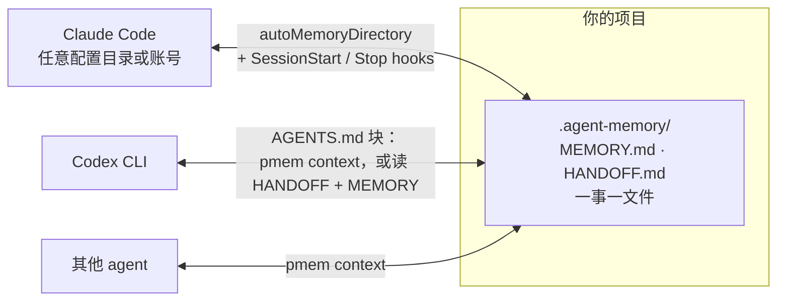

# project-memory

[English](README.md) | **简体中文**

**记忆跟着项目走，不跟着 agent 走。** Claude Code、Codex 和你用的每个账号读写同一个 `.agent-memory/` 目录，随时可以恢复项目或换 agent 接着干，会话因额度用尽中断也不怕。

## 问题

Claude Code 的自动记忆存在 `<配置目录>/projects/<启动路径的 slug>/memory/` 里。这个位置同时绑定了一个 agent、一个配置目录或账号、一台机器上的路径和一个启动路径：Codex 看不到它，换个账号就是空的，每个 worktree 或子目录还会各长出一份互不相通的记忆。会话因额度用尽停下，换到 Codex 或另一个账号时，新会话两眼一抹黑。project-memory 把记忆搬进项目本身，并让每个 agent 先读它。

## 工作方式



- **Claude Code**：`pmem init` 在项目的 `.claude/settings.local.json` 里写入 `autoMemoryDirectory`，Claude 原生记忆从 `.agent-memory/` 加载 `MEMORY.md`，新记忆也存到这里。同一文件还加了 hooks：`SessionStart` 注入当前交接和需要注意的检查点，`Stop`、`StopFailure`、`PreCompact` 写机械检查点。设置文件在项目里，所以每个配置目录、每个账号都会读到。
- **Codex**：`pmem wire codex` 在 `${CODEX_HOME:-~/.codex}/AGENTS.md` 里加一小段：找最近的 `.agent-memory/`，运行 `pmem context`（或读 `HANDOFF.md`、较新的检查点和 `MEMORY.md`），每次修改都写上 `metadata.modified`。
- **其他 agent**：`pmem context` 一次打印交接、检查点和索引。
- **五个 skill** 告诉 agent 什么时候读、存、交接、整理。`pmem` 是单文件 Python CLI，支持 Python 3.9 及以上，只用标准库，负责记账。

## 安装

需要 Python 3.9 及以上和 Git。每个 agent 选一种方式。

**Claude Code 插件**，在 Claude Code 中执行：

```text
/plugin install project-memory --marketplace SuperFCR/falcary-skills
```

较早版本的 Claude Code 分两步：`/plugin marketplace add SuperFCR/falcary-skills`，再 `/plugin install project-memory@falcary-skills`。

**复制安装**，适用于 Claude Code、Codex 或任何读取 `SKILL.md` 目录的 agent：

```bash
git clone https://github.com/SuperFCR/falcary-skills.git && cd falcary-skills/project-memory
./install.sh --link-cli              # → ${CLAUDE_CONFIG_DIR:-~/.claude}/skills，并链接 ~/.local/bin/pmem
./install.sh --codex --wire          # → ${CODEX_HOME:-~/.codex}/skills，并写入 AGENTS.md 块
./install.sh --config-dir ~/.claude-work --config-dir ~/.claude-personal   # 多个账号
./install.sh --target DIR            # 其他 skills 目录
```

已存在的同名 skill 会先移到 `<目标目录>.bak/<name>-<时间>`，不在 agent 扫描的目录里。`--wire` 对 `--codex` 执行 `pmem wire codex`，对每个 Claude 配置目录执行 `pmem wire claude`。

**每个 Claude 配置目录装一次**。Claude Code 的插件、skills 和全局 `CLAUDE.md` 按配置目录（`~/.claude` 或 `$CLAUDE_CONFIG_DIR`）分开存放。靠切换配置目录来切换账号的，每个配置目录都要装一次插件，或把每个目录都传给 `install.sh --config-dir`。项目接线是共享的：它在项目里，hook 脚本是 `${XDG_DATA_HOME:-~/.local/share}/project-memory/pmem.py` 处的稳定副本，不在任何配置目录里。更新插件或 skill 后，用 skill 目录里新的 `pmem.py` 在任一项目运行一次 `pmem init`，刷新这个副本。

**`pmem` 命令**。`--link-cli` 会把它放到 PATH 上，插件不会。插件用户可以直接对 agent 说“给这个项目建记忆”，它会从 skill 目录运行 `pmem.py`；第一次 `pmem init` 之后，用 `ln -s "${XDG_DATA_HOME:-$HOME/.local/share}/project-memory/pmem.py" ~/.local/bin/pmem` 链接稳定副本；Claude 会话开始注入的上下文里也写着这个副本（`CLI: python3 '…'`）。没有链接时，下文的 `pmem` 指 `python3 <skills 目录>/project-memory/scripts/pmem.py`。

## 快速开始

每个项目一次。git 仓库里任意位置都行，会落到主 checkout 根目录；其他情况请在项目顶层运行，或加 `-C <根目录>`：

```bash
pmem init              # 创建 .agent-memory/、私有历史，接线 Claude Code
pmem import --claude   # 导入 Claude 按路径存放的旧记忆；可先加 --dry-run
pmem wire codex        # 每台机器一次：告诉 Codex 去哪里找
pmem status            # 核对接线
```

之后新开一个 Claude Code 会话，设置在启动时读取。放在 `CLAUDE.local.md` 里的笔记可以用 `pmem import --file CLAUDE.local.md` 一并导入。Claude 为上级目录、用户级 `autoMemoryDirectory` 或在子目录启动的会话留下的记忆只列为候选、不自动导入；子目录的那些已按 transcript 里的 `cwd` 核实。看过后用 `pmem import <dir>` 逐个导入。`init` 是幂等的，再跑一次只会补齐缺的部分。

## 日常使用

skill 很少需要点名调用，它们按对话里发生的事触发：

| Skill | 什么时候触发 | 典型说法 |
| --- | --- | --- |
| [project-memory](skills/project-memory/SKILL.md) | 会话开始或恢复、调试报错前、任何关于记忆的问题；也负责安装接线与迁移 | “给这个项目建记忆”“记忆在哪” |
| [memory-learn](skills/memory-learn/SKILL.md) | 被纠正、确认了不寻常的做法、试了 3 次以上才修好、发现新约束之后，当场记一条 | “记住这个”“以后别这样”“remember this” |
| [memory-reflect](skills/memory-reflect/SKILL.md) | 会话收尾或提交前，回顾整段对话 | “今天先到这”“收尾”“wrap up” |
| [memory-handoff](skills/memory-handoff/SKILL.md) | 里程碑、启动长任务或远程任务前、停下前、换 agent 时 | “交接一下”“继续上次的任务”“换 Codex 接着做” |
| [memory-health](skills/memory-health/SKILL.md) | 每周一次，或 `pmem lint` 报警时：核实、合并、拆分、归档、压缩索引 | “整理记忆”“memory health” |

典型的一天：会话开始时 agent 读交接，干活中随时记经验，每到里程碑更新交接，收尾时做一次 reflect 回顾。新建记忆、更新自己的交接这类低风险改动 agent 直接做；改写已有记忆做完说明；归档仍有独有内容的记忆、放宽已有规则、改 `CLAUDE.md` / `AGENTS.md`（包括 `pmem wire`）前先问。从不删除：`pmem archive` 把文件移进 `.archive/`，“忘掉这条”也是这样做。只删索引行不够，`pmem index --fix` 会把它加回来。

## 切换 agent 与账号

交接是会话之间的约定：目标、已完成、下一步、现场状态（每项附一条核对命令）、生效中的决定与约束、未决问题。agent 在每个里程碑更新它，突然中断时损失很小。

Claude Code 会话因额度用尽中断时：

| 步骤 | 发生什么 |
| --- | --- |
| 1. 会话停下 | `StopFailure`（或 `Stop`）hook 写 `.checkpoints/<key>.md`：时间、错误、会话 ID、transcript 路径、分支、HEAD、未提交文件数、最后一条助手消息的结尾。更早会话留下的检查点先移到 `<key>.prev.md`。hook 从不改交接。 |
| 2. 你切换 | 在同一项目里打开 Codex，或用另一个账号打开 Claude Code。 |
| 3. 新会话开始 | Claude 收到注入的交接和完整的检查点，标题写明错误类型，如 `rate_limit`。Codex 的 AGENTS.md 块让它运行 `pmem context`，看到的内容相同；没有 `pmem` 时它直接读交接和检查点文件。 |
| 4. 在第一轮回复里补上进度 | `pmem sessions --since-handoff --tail 20` 列出本工作流在交接之后的会话，包括检查点里记下的其他配置目录中的中断会话和在子目录启动的会话，并打印最后几条消息。 |
| 5. 继续 | agent 核实现场（分支、HEAD、任务进程、远程目录），记下旧 transcript 路径，更新交接后接着干。 |

为什么要在第一轮回复里做：新会话自己的检查点会把那次失败挤出去。它在本会话剩下的时间里留在 `<key>.prev.md`，再换一次会话就没了；之后只有 `pmem sessions --config-dir <旧账号的配置目录>` 能找到旧 transcript。先看会话再改交接，因为改交接会把 `--since-handoff` 的截止时间推到现在。

pmem 同时看当前检查点和上一个会话的检查点。任何一个是比交接新的 `StopFailure`，或比交接晚 10 分钟以上、说明交接落后，就完整显示；`Stop` hook 每轮结束都会触发，所以检查点比交接稍新是常态。否则会话开始时只有一行：停止后是 “Last session ended normally at … (session …, transcript …); handoff is current.”，压缩后是 “Last checkpoint: PreCompact at … (session …)”。交接的时间取 `metadata.modified` 与文件修改时间中较晚的一个，agent 忘了改时间戳也不会误报。交接比那次失败新之后，完整段就不再出现。

Codex 会话没有自动检查点，状态全靠交接传递；`pmem sessions` 仍能找到 Codex 的 transcript。

## 目录里有什么

```text
<project>/.agent-memory/
  MEMORY.md              索引，Claude Code 原生加载
  HANDOFF.md             主 checkout 的实时状态（不是记忆）
  handoffs/<key>.md      并行工作流的实时状态（linked worktree 或 --key）
  <name>.md              一事一文件
  .archive/              退役的记忆（交接在 .archive/handoffs/），原生扫描看不到
  .checkpoints/<key>.md  只由 hooks 写；<key>.prev.md 保留上一个会话的
  .git/                  私有历史（默认开启）
  .gitignore、.imported.json、.pmem.lock
```

记忆文件的 frontmatter 与 Claude Code 原生写入的一致：

```markdown
---
name: tests-need-redis
description: 集成测试依赖本地 6379 端口的 Redis，未启动时报连接拒绝而不是跳过
metadata:
  type: project
  modified: 2026-11-23T02:31:00Z
---

跑集成测试前先启动 Redis。
**Why:** 测试夹具不检查 Redis 是否可用，失败看起来像代码错误。
**How to apply:** 跑 `pytest tests/integration` 前先 `redis-cli ping`。
```

- **类型**：`user`、`feedback`、`project`、`reference`。试了多次才修好的故障记成 `fix-<topic>`：描述以原样的报错开头，正文写 `**Symptom:**`、`**Root cause:**`、`**Fix:**`。
- **索引**：`MEMORY.md` 里每条记忆一行 `- [标题](name.md) — 钩子`，HANDOFF 行排第一。pmem 只改这类链接行，标题和正文一概不动；代码段、HTML 注释和代码块里的链接不算。
- **链接**：记忆之间用 `[[name]]`；只写绝对日期。

Claude Code 最多加载索引的 200 行或 25,000 字符，召回时只显示记忆文件的前 4096 字节，所以 `pmem lint` 定了更紧的线：

| 检查项 | 警告 | 错误 |
| --- | --- | --- |
| 索引行数 | 150 | 200 |
| 索引字符数 | 20,000 | 25,000 |
| 记忆或交接文件 | 4 KB | |
| 单行索引长度 | 150 字符 | |
| 交接多久没更新 | 14 天 | |

## Git、隐私与私有历史

- **默认私有**。`pmem init` 把 `.agent-memory` 和 `.claude/settings.local.json` 加进项目的 `.git/info/exclude`，`git status` 里看不到，也不会被提交或推送。
- **私有历史**。记忆目录本身是一个小 Git 仓库。pmem 每次改动后自动快照，每次 Claude 会话开始时也在后台快照。这些快照会把所有人的改动一并收进去，所以用 `pmem diff --since-health` 回看：上次 memory-health 以来原生记忆或其他 agent 改过的全部内容。`pmem history` 看日志，`pmem restore` 找回文件。历史命令只作用于 `.agent-memory/.git`；它损坏时 pmem 报 “private history broken”，绝不退回到项目仓库。作为嵌套仓库，项目的 `git clean -fdx` 会跳过它，只有 `git clean -ffdx` 会删。不要历史就加 `--no-history`；这时它只是一个被忽略的目录，`git clean -fdx` 会把它删掉。
- **与团队共享**。`pmem init --track` 不再排除记忆目录，由你随项目提交；交接和检查点仍被忽略。这种模式下不写个人 `user` 事实，提交前跑 `pmem lint --strict`。
- **同一仓库只用一种模式**。git 把被忽略的文件当作可以丢弃的。一旦有人提交了 `.agent-memory/`，无论是用 `--track` 还是误提交，别人 pull 或 checkout 那个提交时私有记忆会被静默覆盖，切回去还可能被删。只要有任何 ref 跟踪了 `.agent-memory`，pmem 会在 init、`status`、`lint` 和会话开始时警告。这种 pull 之前先快照：`pmem restore` 只能恢复到最后一次快照。
- **不存密钥**。记忆只记凭据存在哪里，从不记值。`pmem lint` 会标出私钥、云服务与 GitHub 令牌、URL 里的密码和 `password=` 这类赋值；确属有意的行加 `pmem:allow-secret`。误写进去的值删掉后仍留在私有历史里，`--track` 时还在项目提交里：按已泄露处理，轮换凭据。
- **关闭后台整理**。Claude 的 auto-dream 可能改写或删除记忆文件，init 会为项目设 `autoDreamEnabled: false`。`--allow-dream` 保持原样；有私有历史，它的改动可以回看。
- **拒绝的情况**。`.agent-memory` 解析到 `$HOME`、其上级、`/`，或项目根本身及其上级时，例如仓库自带的符号链接，pmem 一律拒绝；记忆目录里的符号链接从不跟随，`pmem lint` 把它们报为错误。`pmem init` 还会拒绝两种情况，除非加 `--force`：不加 `--track` 却要复用已被项目 Git 跟踪的记忆目录；Claude 根目录会是 `$HOME`、其上级或 `/`，例如 `$HOME` 本身是 dotfiles 仓库。

## Worktree、并行 agent 与非 git 工作区

- **linked worktree 共用主 checkout 的记忆**。pmem 和 Claude Code 都从主 checkout 解析 `.agent-memory/`，所有 worktree 看到同一份知识；在 worktree 里跑 `pmem status` 可以确认。每个 linked worktree 有自己的交接 `handoffs/<worktree 名>.md`，主 checkout 用 `HANDOFF.md`。名为 `main` 的 worktree（bare 仓库布局里常见）用 `handoffs/worktree-main.md`。worktree 删除后，memory-health 用 `pmem archive handoffs/<名字>` 退役它的交接；`HANDOFF.md` 本身从不归档。
- **并行 agent**。首选一个 agent 一个 worktree。同一 checkout 里的两个 agent 各需要一个 key：用 `PMEM_KEY=agent-b claude` 或 `PMEM_KEY=agent-b codex` 启动，它的 hooks 和每条 pmem 命令都会用 `handoffs/agent-b.md` 和单独的检查点。单条命令加 `--key NAME` 也行，但 hooks 只认环境变量。Codex 会把 `PMEM_KEY` 传给它运行的命令，除非它的 `shell_environment_policy` 丢弃名字含 `KEY` 的变量（`ignore_default_excludes = false`）。索引在文件锁下修改，一事一文件也让写冲突很少。
- **不要放在 linked worktree 里**。`git worktree remove` 会删掉被忽略的文件，所以 `pmem init` 拒绝在那里建记忆，`pmem status` 报为错误。
- **非 git 工作区**。在包含多个仓库的工作区顶层运行 `pmem init`，例如一篇论文连同它的代码和工具：它在那里建一份记忆，并把两层以内的每个子仓库接到它上面。在 Git 之外，Claude Code 只从启动目录读取 `.claude/settings.local.json`，所以要在顶层或某个子仓库里启动 Claude。在普通子文件夹里启动的会话既没有记忆也没有 hooks，`pmem status` 在那里会报接线不生效。自带 `.agent-memory/` 的仓库保留自己的：最近者生效，嵌套记忆从不合并。
- **新克隆或新机器**。`.claude/settings.local.json` 只属于本机，到那边要重新 `pmem init`。私有模式下记忆不随项目走，自己同步 `.agent-memory/`，它本身就是 Git 仓库。

## Codex 说明

- Codex 读 `${CODEX_HOME:-~/.codex}/AGENTS.md` 和从仓库根到工作目录的各级 `AGENTS.md`，不读 `CLAUDE.md`。`pmem wire codex` 把 project-memory 块加进全局文件，每个 `CODEX_HOME` 一次。`pmem wire <root>/AGENTS.md` 则写进项目文件，`pmem status` 两种都认。已验证：在子目录启动的 Codex 能找到并读取 `<root>/.agent-memory/MEMORY.md`。
- 项目指令只写在 `CLAUDE.md` 里的，在 Codex 的 `config.toml` 里设 `project_doc_fallback_filenames = ["CLAUDE.md"]`，让 Codex 也读到。
- **来自 Claude 的检查点**。块里让 Codex 在会话开始时运行 `pmem context`，它会把交接连同已停止的 Claude 会话留下的检查点一起显示。这要求 Codex 的 PATH 上有 `pmem`，例如用 `install.sh --link-cli`；否则 Codex 直接读 `HANDOFF.md` 和 `.checkpoints/<key>.md`。
- **沙箱**。`workspace-write` 模式下 Codex 只能写工作目录以下，外加 `/tmp` 和 `$TMPDIR`（除非被排除），所以放在 `/tmp` 下的项目碰不到这个问题。从子目录、子仓库或 linked worktree 启动时，写不了上级的记忆：从项目根目录启动，或加 `--add-dir <项目根目录>`。不要只加记忆目录：Codex 把每个可写根下的 `.git` 设为只读，`--add-dir <memdir>` 会让私有历史无法快照。`pmem status` 会打印该从哪个根目录启动，以及 `--add-dir` 的路径。
- Codex 有自己的全局 `[memories]` 功能，与本工具互不相干，可以继续开着；块里写明了项目知识归 `.agent-memory/`。
- 本版本没有接 Codex 的 hooks，Codex 会话突然中断不会留下检查点。

## 从 /learn、/reflect、/evolve 迁移

旧体系把经验写进 Claude 按路径存放的记忆，再把信号写进 `evolve-queue.jsonl` 交给后台 agent 处理。本工具取代它：

| 旧 | 新 | 变化 |
| --- | --- | --- |
| `/learn` | [memory-learn](skills/memory-learn/SKILL.md) | 同样 30 秒记一条，写进共享的 `.agent-memory/`，用 `pmem find` 去重 |
| `/reflect` | [memory-reflect](skills/memory-reflect/SKILL.md) | 回顾整段对话，按改动风险表直接写；仍会提醒实验日志里未收尾的条目 |
| `/evolve` 日报与上下文瘦身 | [memory-health](skills/memory-health/SKILL.md) + `pmem lint` | 过期、超长、重复的记忆，死链和不存在的路径都成了 lint 结果；`pmem diff --since-health` 取代变更日志 |
| `/evolve sweep`、evolve-trigger 规则、队列 | [project-memory](skills/project-memory/SKILL.md) 里的保存时机 | 谁看到谁当场存 |
| harness-evolution 规则 | 故障格式 + 改动风险表 | `fix-<topic>` 记忆写 Symptom / Root cause / Fix；“调试前先查记忆” |
| harness-health | 不移植 | 按代码审计项目自己的规则和 agent 文件，因项目而异；记忆里的路径漂移由 `pmem lint --paths` 检查 |

**为什么去掉队列、后台 agent 和学习用的 hooks**。排队的信号到后台 agent 手里时已经脱离了产生它的对话，经验丢了“为什么”，有风险的改动却在无人看管时发生。后台 agent 每个任务后都要花 token，还和主会话抢着改同一批文件。现在由看到事件的 agent 当场写记忆，有风险的先问；剩下的 hooks 只写检查点，从不碰记忆，并且总是以 0 退出。

**退役旧体系**，`pmem status` 发现旧体系的痕迹后，agent 会和你一起做：

1. `pmem init`，再用 `pmem import --claude` 导入按路径存放的旧记忆，用 `pmem import --file CLAUDE.local.md` 导入笔记。
2. `.claude/evolve/evolve-queue.jsonl` 里每一条未处理的信号，要么变成一条记忆，要么明确放弃。
3. 征得你同意后，把旧规则、旧 skill 和 `.claude/evolve/` 移到 `.claude/legacy-harness/`，并去掉调用它们的 hooks。移动，不删除。
4. 跑一次 memory-health，合并 `*-imported*` 重复项，把 `imported-notes*` 拆成一事一文件。

## pmem 速览

| 命令 | 作用 |
| --- | --- |
| `pmem init` | 创建或复用记忆并接线 Claude Code，幂等 |
| `pmem status` | 记忆、索引容量、交接、历史、Claude 与 Codex 接线、git 模式、待迁移来源 |
| `pmem context` | 交接、本会话与上一个会话的检查点（出错停止或交接落后时完整显示）、其他交接和索引，一次输出 |
| `pmem handoff [show\|path\|list]` | 显示、定位或列出交接 |
| `pmem add` · `find` · `archive` | 保存、搜索、退役记忆与已结束的交接 |
| `pmem index [--fix]` · `lint` | 保持索引与文件一致 |
| `pmem import` | 导入 Claude 按路径存放的记忆、目录或笔记文件，从不修改来源 |
| `pmem wire codex\|claude\|FILE` | 在全局或项目指令文件里添加、更新或移除块，改前备份 |
| `pmem snapshot` · `diff [--since-health]` · `history` · `restore` | 私有历史；`--since-health` 回看上次 memory-health 以来的全部改动 |
| `pmem sessions` | 本项目近期的 Claude 与 Codex transcript（含在子目录启动的会话），标出所属工作流，并给出最后几条消息 |

每个子命令都有 `--help`，`--key` 默认取 `$PMEM_KEY`；完整参考见 [project-memory skill](skills/project-memory/SKILL.md)。skill 正文用中文写成，agent 用任何语言都能照做。

## 已知限制

- 需要支持 `autoMemoryDirectory` 的 Claude Code。已验证 Claude Code 2.1.322 与 Codex CLI 0.164；升级后请重新核对。
- 设置了 `CLAUDE_CODE_DISABLE_AUTO_MEMORY`、使用 `--bare` 模式（`CLAUDE_CODE_SIMPLE`）、`autoMemoryEnabled: false`，或 `CLAUDE_COWORK_MEMORY_PATH_OVERRIDE` 指向别处时，Claude 原生记忆关闭。SessionStart hook 在这样的会话里运行时会自己注入 `MEMORY.md` 并给出警告；`pmem status` 会报告涉及的环境变量和设置。
- 没有接 Codex 的 hooks；Codex 从项目根以下启动时需要 `--add-dir <项目根目录>` 才能写记忆。
- frontmatter 解析器只认一个小的 YAML 子集：每个值写在一行里。多行值读不到，`pmem add --force` 会丢掉 `metadata: {…}` 这种写法里的其他键。
- `pmem wire` 不支持只用 CR 换行的文件。
- 只支持 Linux 和 macOS，含 WSL；原生 Windows 未测试。

## 开发

```bash
cd project-memory
python3 -m unittest discover -s tests -t . -v
```

测试需要 Git，在临时目录中运行，`HOME`、`XDG_DATA_HOME`、`CODEX_HOME`、`CLAUDE_CONFIG_DIR` 全部重定向。CI 在 Ubuntu、macOS 和 Python 3.9 上运行测试，并对 `install.sh` 跑 shellcheck。

## 许可证

[MIT](../LICENSE)
